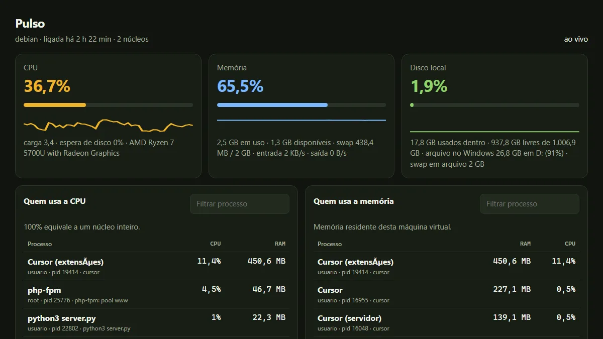
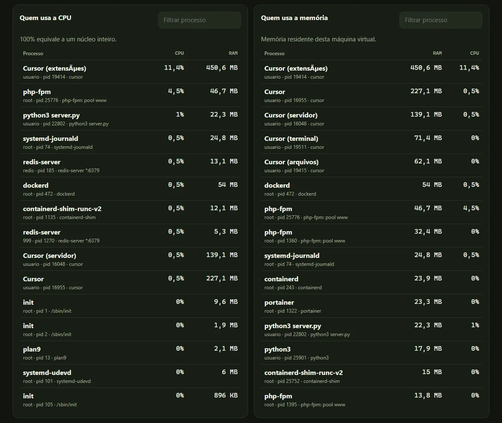
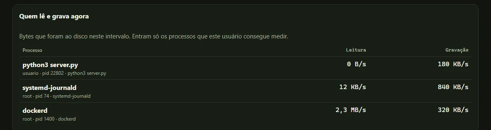
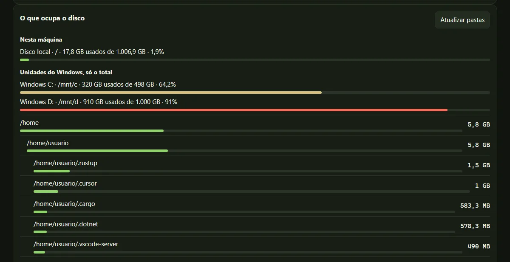
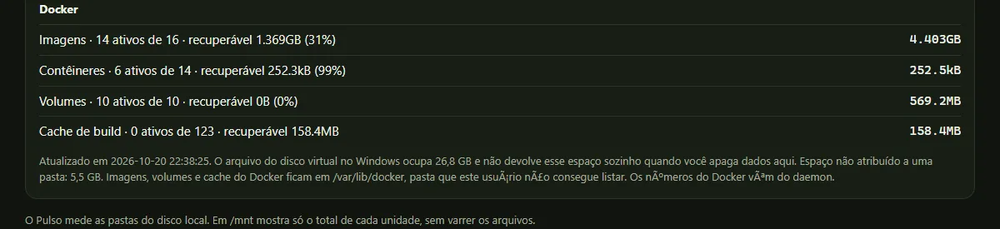

# Guia do Pulso

Amostra do painel. Dá para ler a tela por aqui, sem clonar e sem subir o servidor. Usuário, caminhos e as unidades do Windows desta amostra são de exemplo.

O uso na sua máquina está no [README](../README.md).

## Os três cartões

A página atualiza sozinha. O cartão de CPU é a máquina inteira, de 0% a 100%. O de memória é o que está em uso, no espírito da coluna disponível do `free`. O de disco local é o sistema de arquivos de `/`.

Na WSL, o mesmo cartão de disco também mostra o arquivo `ext4.vhdx` no Windows. Esse arquivo não encolhe sozinho quando você apaga dados dentro do Linux. O `df` e o arquivo podem divergir, e os dois podem estar certos.



## Quem usa CPU e memória

`100%` na lista é um núcleo inteiro, o mesmo critério do `top`. Numa máquina de dois núcleos, um processo pode passar de 100%. A memória da lista é a RAM residente.

O campo **Filtrar processo** restringe a lista que já está na tela. Vale nome, usuário ou pid.



## Quem lê e grava

Entram os bytes que o processo enviou ao disco naquele intervalo. Se ninguém gravou, a tabela diz isso.



## O que ocupa o disco

O disco local e as unidades montadas em `/mnt` ficam separados. Em `/mnt` o Pulso mostra só o total. Não percorre os arquivos do Windows.

A árvore lista os maiores diretórios do disco local. A primeira leitura pode levar cerca de um minuto. **Atualizar pastas** mede de novo. Pasta que o seu usuário não pode ler fica de fora e entra em “espaço não atribuído”.



Se o comando `docker` funciona, a seção **Docker** traz imagens, contêineres, volumes e cache de build. Esses números vêm do daemon. A pasta `/var/lib/docker` em geral não é legível pelo usuário do painel.



## Subir na sua máquina

```bash
git clone https://github.com/araguaci/pulso.git
cd pulso
python3 server.py
```

Abra <http://127.0.0.1:8787>. Na WSL2, o navegador do Windows alcança <http://localhost:8787>.

O painel não pede senha. Não encaminhe a porta para a internet. Se outras pessoas alcançam o IP desta máquina, use `python3 server.py --host 127.0.0.1`.
